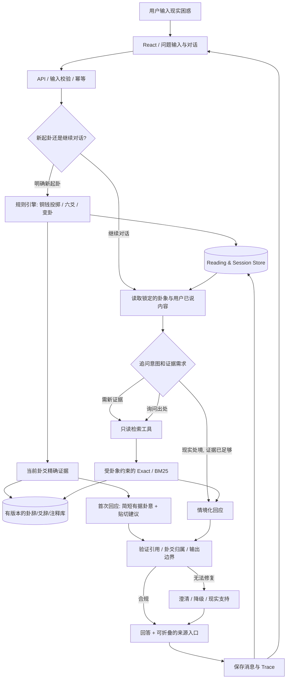
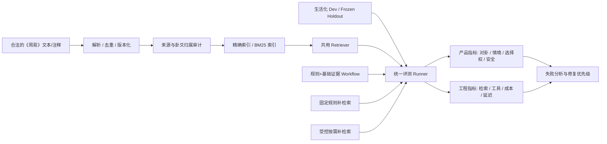
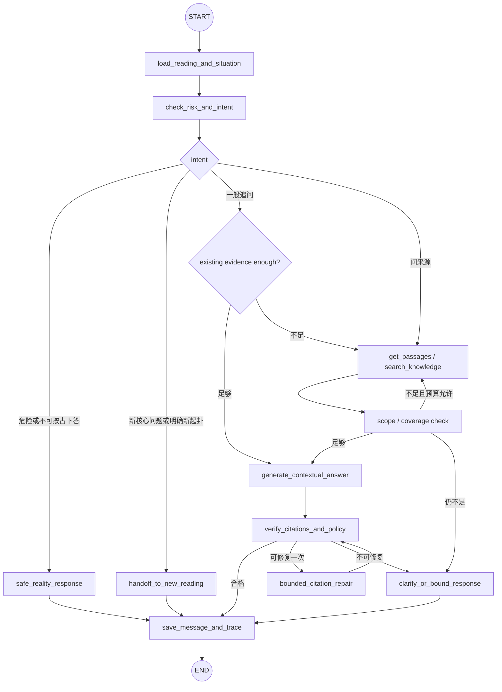

# architect.md — 《周易》情境解读应用：产品导向的技术架构

自主实验修订（2026-10-10）：当前 graph v13 / prompt v16；主回答采用 Flash enabled / low / 8192，校验修复使用同模型 disabled / 8192 并提供错误位置及原因；非思考候选经盲评后未替换质量默认配置。路由只传所需证据字段，明确授权文献目标取齐后直接生成；完整来源、权限与校验保留。模型筛选、RAG 消融、B/C/D、图版本对照和隔离小留出均单列，见[结果与局限](evaluation/autonomous-optimization-20261010.md)。这些实验不代表人工对话质量验收。

上一轮提示词减法修订（2026-10-10）：当时为 graph v10 / prompt v16，保留普通段落与 claim 引用契约。清理 SYSTEM、ROUTER、RISK_SYSTEM、动态指令、repair 和工具描述；技术约束继续由程序保障。生成机制、Schema、校验器和前端保持，表达质量以真实回答复核，见[本轮完整提示词、删减与对照](evaluation/prompt-subtraction-20261010.md)。

> **关联需求**：[SPEC.md](./SPEC.md)  
> **架构版本**：v1.5 · 2026-10-10（目标设计，非现状完成声明）
> **核心原则**：**计算由规则保证，传统解读由可定位文献约束，生活化交流由受限 LLM 完成；技术可观测，但不强迫用户进入知识检索界面。**  
> **技术决策**：保留 React 前端，将核心后端迁移为 Python + FastAPI + LangGraph。用户以掌握 Agent / LLM / LangGraph 为学习目标，不要求学习 TypeScript 或前端开发。旧 `server/*.ts` 作为迁移对照与回滚版本，保留 API、知识发布和会话兼容性。

## 历史：2026-10-08 回答约束修订（段落类型规则已被 v15 替代）

以下保留历史决策及验证背景；其中 kind 分型、混合内容拆段和旧摘要要求不再是当前契约。当前规则见本文自然对话修订及输出说明。

该次修订落实既有产品目标，不增加新服务或第二套编排。该次修订实现为 `python-graph-v4` / `evidence-agent-python-v5`，验证与保留问题见 [本轮验收](evaluation/acceptance-20261008-followup.md)。

- 新答案段落增加 `kind`：`interpretation` 只解释传统材料且必须引用；`reflection` 用于现实建议、澄清或限制说明且引用为空；可承接前文已获支持的传统含义建立明确类比，不新增古籍事实。混合内容应拆段，不靠更换标签绕过校验。机械约束不等于语义支持已经成立。
- 路由保留必要执行上下文；最终生成使用核心问题、当前问题、有限近期对话、相关原文和限制说明，不携带原始工具日志；当前改为携带有限的近期用户／助手对话，长回答标记节选。没有引入长期记忆或用户画像。
- 按当前发布集的精确元数据区分“未收录”和“尚未取得”；未知书名可能是别名，关键词零结果也不证明全库没有。指定作者／作品时筛选生成及校验可见的证据，不以别家观点替代。
- 明确要求重新起卦时，既有 prepare 节点直接生成操作提示并到 finish，不请求模型或自动换卦。风险回答不注入卦象原文；仍采用现有有限规则识别，不宣称完整安全分类。
- 新输出必须满足段落契约；历史答案无 kind 仍可展示，不伪造回填。旧中断 checkpoint 按版本兼容规则处理，保留会话历史，不增加过渡适配壳。

## 1. 核心架构判断（ADR-001：Product First）

### 1.1 产品问题驱动的三条业务链

1. **可核验的起卦链**：明确传统规则 → 受控随机数 → 六爻/本卦/动爻/变卦 → 持久保存 → UI 展示。LLM 不参与计算。
2. **有真实依据的首次解读链**：固定读取当前卦象匹配的卦辞/爻辞/相关注释 → 结合用户实际提问 → 生成文化性解释与现实反思选项 → 校验来源。无需强行 Agent 化。
3. **以真实困扰为中心的追问链**：理解用户继续谈的处境 → 判断已有上下文是否足够 → 必要时受控检索传统材料 → 回应现实问题 → 验证引用并保存上下文。

**重要架构反转**：旧版把“文献问答”放在中心；新版把“用户具体困境”放在中心。用户是否关心作者和原文，只影响是否展开证据 UI，**不决定系统后台是否需要依靠文献解释卦象**。

### 1.2 领域边界和术语

- 本期实现的是**三枚铜钱六次投掷的《周易》卦爻结果与解读**；不宣称完整实现纳甲六爻（干支、六亲、六神、世应等）。
- 系统可以证明某次卦象按既定计算规则得出、相应文字来自指定材料，**不能证明卦象能预测未来**。
- 不引入八字/奇门等计算；如果日后增加，需要独立规则模块、历法/时区测试和产品同意后再启用。
- 对现实选择的建议是**一般性、非宿命的思考帮助**，不是传统文本已证明的个人命运结论。

### 1.3 技术分层

| 层 | 负责什么 | 不能做什么 |
|---|---|---|
| `domain` | 铜钱起卦、64 卦映射、动爻与变卦、解释规则版本 | 让 LLM 代算；绕过幂等重算原卦 |
| `knowledge` | 古籍来源管理、原文定位、精确检索、BM25、版本 | 把其他卦的引用伪装成当前卦；凭空创作原文 |
| `conversation` | 提取用户显式情境、判别追问意图、决定是否补检索 | 编造用户经历；因新追问默默重新起卦 |
| `llm` | 将文献传统解释转为可理解的情境化回答 | 声称预测确定未来；擅自调用不允许的工具 |
| `validation` | 引文来源、卦象范围、文本匹配与响应契约检查 | 把机械通过等同于语义论证成立 |
| `api/persistence` | 会话、reading、消息、幂等、失败状态与删除 | 将 checkpoint 当作事务保障 |
| `evaluation/observability` | 用户体验评分、对照、Trace、成本与故障诊断 | 用通过的 mock 测试冒充真实用户收益 |

### 1.4 LangChain / LangGraph / 原生 Loop 决策

| 选择 | 当前判断 |
|---|---|
| 原生工具 Loop | **保留作为迁移基线与回滚手段**，供 LangGraph 接入前后核对行为与 Trace |
| LangChain `createAgent` / 模型适配 | **可选复用**模型/工具 schema 与调用适配；不要求全业务迁移 |
| Python LangGraph `StateGraph` | **P0 必须采用**：在实际追问链实现状态、条件路由、受控工具调用、持久检查点与恢复 |
| 整仓 LangGraph 化 / 多 Agent | **不推荐**：起卦与基础证据检索是确定性逻辑，改成 Agent 会引入风险与维护成本 |

本期必须通过实际接入 LangGraph 学习并掌握 Agent 的状态、路由、工具与恢复机制，形成可演示、可解释的简历项目。验收以真实执行路径、持久化恢复和回归证据为准；控制实现范围，不追求系统究极完美。框架无法天然提高证据质量或让占卜变得科学。

---

## 2. 总体架构图

### 2.1 业务主路径（首次起卦 + 情境对话）



**主链设计要点**：

- 用户首屏不出现检索结果排名、框架节点、原始 JSON 或工具列表；它们只用于后台和演示模式。
- “继续谈现实处境”即使不调用工具，也是一条完整的成功路径。
- **卦象由业务数据库持久化且不可变**，后续路由只读其标识；只有用户明确新建 reading 才启动 RNG。
- 解释引用可以按需展开，但主要文化解释所依赖的文本应在后台可追踪。

### 2.2 离线知识与双轨评测



---

## 3. 核心领域模型与计算设计

### 3.1 `Reading` 是整个系统的业务真相来源

概念性 Python 数据模型；对外 JSON 继续兼容旧前端的 camelCase 字段：

```python
from typing import TypedDict

class Reading(TypedDict):
    id: str
    method: str
    algorithmVersion: str
    coins: list[list[int]]  # 6 组，每组三枚 0/1，映射为 2/3
    lines: list[int]        # 六个 6/7/8/9，自下而上
    original: dict         # number / name / binary
    changed: dict          # 为兼容前端保留；无动爻时与 original 相同
    changingIndices: list[int]

# 情境记忆本期使用有限对话窗口；结构化 concerns/constraints 后续按需增加。
```

**一个会话只有一个核心问题和一个 reading**。新问题创建新 session 和新卦，不把旧会话历史传入；旧业务记录不因新建自动删除。`UserSituation` 属于会话资料，不得悄悄升级成跨用户长久人物画像。

### 3.2 投掷和卦象计算规则

推荐实现（**明确这是三枚铜钱法的一个约定，须在产品内注明**）：

- 每枚硬币独立从受控伪随机源得到二值，映射为 `2/3`；每次三枚求和得到 `6/7/8/9`。
- 六次结果按**由下到上**对应初爻至上爻。
- `6`：老阴，变为阳；`7`：少阳，不变；`8`：少阴，不变；`9`：老阳，变为阴。
- 本卦由阴阳线和固定六十四卦映射表得到；变卦按动爻翻转计算；变爻选择和多动爻的**解读材料选择**是两件不同事。
- 三枚公平二值硬币的数值出现概率约定为 `6/7/8/9` 对应 `1/8、3/8、3/8、1/8`；统计检查只是随机源的工程健全性检测，**不能证明“神意”或真实世界预言**。

**实现要点**：

- 生产使用 Python `secrets.randbelow(2)`（或等效强伪随机源）；测试注入固定 CoinSide 序列，不能允许生产请求指定测试种子。
- 六十四卦映射表、上下卦方位、动爻解读选择应有可查版本与固定测试向量。多动爻如何用辞，选择一套并说明版本，不把某种解释习惯声称为全体学派唯一规则。
- 记录 `cast` 与 `ruleVersion`，可以**复算**卦象；`idempotency_key` 绑定一次创建请求，相同内容返回同一 `Reading`。
- LLM 只能读取只读 `Reading` 快照；不能重新掷币、选择“更合适”的卦或改变动爻。

### 3.3 `domain` 模块接口

```python
def sample_cast(next_bit=None) -> dict:
    """生产使用 secrets.randbelow；next_bit 仅供测试注入。"""
    ...

def calculate_hexagram(lines: list[int]) -> dict:
    """纯函数校验并计算本卦、动爻和变卦。"""
    ...
```

应先审计现有规则再建立这些边界；Python 迁移保持这些职责边界；API 字段继续兼容现有前端。

---

## 4. 文献/知识层设计：证据为情境解释服务

### 4.1 两种不同的检索需求

**A. 基础卦象解读（确定性取得）**：给定 `Reading`，按当前卦、动爻和解释策略获取对应卦辞、爻辞、必要的小象与少量适用注释。**不让向量检索猜当前到底是哪一卦**。

**B. 自然语言追问（条件性检索）**：如果用户提出关于卦象寓意、作者说法或需要新传统背景的问题，先评估现有证据是否足够；不足时在受约束的范围内用精确检索或 BM25。若用户只是希望分析换工作的风险、如何沟通，则可直接使用现有证据和用户事实，不强制检索。

### 4.2 知识条目结构

```python
from typing import TypedDict

class Evidence(TypedDict, total=False):
    id: str
    releaseId: str
    hexagramId: int
    section: str
    line: int | None
    text: str
    textOriginal: str
    layer: str
    authorIds: list[str]
    workId: str
    editionId: str
    source: str
    locator: str
    correctionHistory: list[dict]

# None 仅用于服务端允许的未知出处查询；模型不能自行扩大范围。
allowed_hexagram_ids: list[int] | None
```

`topicTags` 可以辅助连接“进退、守成、沟通”等生活化问题与传统文本，前提是可审计的**编辑层元数据**。不能把“换工作”映射表包装成出自古籍的原始知识。

### 4.3 检索接口与约束

```python
def initial_evidence(cast: dict, question: str, release: str) -> list[dict]: ...

def retrieve_exact(args: dict, release: str, scope_ids: list[int] | None) -> dict: ...

def retrieve_lexical(args: dict, release: str, scope_ids: list[int] | None) -> dict: ...
```

- `getReadingEvidence` 是起卦后固定阶段，和 Agent 是否选择工具**没有关系**。
- `search` 默认使用当前卦象相关范围，用户未明确要求跨卦比较时不自动扩大 `allowedHexagramIds`。
- 关键硬过滤在 SQL/index/retriever 层进行，**不能只靠 LLM 提示词**。
- 语料库导入保存来源、著作、版本、许可证、章节、爻位；ID 和语料版本稳定，能重建索引、对照审计差异。
- 中文精确查找/BM25 可保留现有双字切分、简繁归一等实现；只有错误分析显示必要，才加入 Embedding、查询改写或 rerank。

### 4.4 为什么默认不展示文献考据

用户主要在谈实际处境。答案必须先能让用户理解，再提供一个轻量的「查看依据」入口，展示：

- “此部分传统解释基于哪一卦/哪一爻/哪段文献”；
- 原文、章节、作者、版本及可用链接；
- 哪些句子只是系统对**用户处境的联想、类比或一般性建议**，不能被当成古籍引文。

引用是后台可信度机制，不是强制用户学习术语的课程。

---

## 5. 情境对话与受控 Agent

### 5.1 追问路由先于“要不要调用工具”

定义内部 Intent（示意）：

```python
from typing import Literal

TurnIntent = Literal[
    "situation_followup", "explanation_followup", "source_request",
    "new_reading_request", "out_of_scope_or_risk",
]
# 确定性初筛处理明确换题；现有 route 通过 newTopic 决策处理隐含新问题，权限仍由程序保证。
```

推荐决策顺序：

1. **安全和输入检查**：高风险现实场景先执行安全边界，不可交给“玄学指导”处理。
2. **新起卦显式操作**：对话中明确“重新起卦”只返回操作提示；用户使用“新建起卦”后才进入 CAST。含糊“那如果换一个选择呢”不是重掷理由。
3. **证据需求判断**：生活化追问先复用当前卦象和用户已提供的信息；文献询问/证据不足才检索。
4. **情境化回答**：回答现实问题，不编造背景、不强行引用古人作直接建议。
5. **来源/边界校验**：区分真实引文、解释性概括与面向现实的建议。

### 5.2 产品输出与 LLM 责任边界

新生成契约采用普通段落和定位引用，移除 summary 与 paragraph.kind。卦义、现实分析和建议允许同段出现，模型自行决定顺序、篇幅和段落；没有润色 Agent 或额外生成步骤。普通首次解读及明确文献问题仍须对应证据；追问可承接已有含义。风险支持和新聊天提示不必引用古籍。

```python
# backend/models.py 校验新生成；旧会话直接读取保存的原数据。
answer = {
    "status": "answered",  # 指定文献目标未完成时为 insufficient
    "paragraphs": [{
        "text": "坎含有重险之意。理发可以去，若想大改造，先把长度与理发师说清楚。",
        "citations": [{"evidenceId": "zy-29-tuan", "quote": "重险也", "claim": "坎含有重险之意。"}],
    }],
    "limitations": [],  # 可选内部记录；重要不确定性必须在正文中说明
}
```

claim 必须是该段 text 中的逐字连续片段，quote 必须匹配对应本轮证据；这只建立引用位置和来源，不证明解释蕴涵或现实建议正确。普通段落可无引用，不再检查传统/现实内容分段。仍校验 Schema、引用 ID/原文、显式作者/作品归属与具体目标；失败最多修复一次，修复不要求拆段。缺资料是业务状态，格式/引用失败是技术失败。

前端 `AnswerBody` 显示完整正文并在 claim 末尾放标记；新 limitations 不再单独挂报告尾。旧 summary、段落和 limitations 保留普通正文展示，旧引用无 claim 时放段尾，不补造定位。近期上下文保留用户/助手角色、旧摘要与限制，长助手回答取首尾、显式标记中间省略；至多六轮，先保留用户原话，再以 16000 字符为目标缩短最长助手摘录；用户文本含大量转义字符时可超出这个软预算，输入仍受六轮和每题 2000 字符上限约束，不是无限记忆。用户更正优先，助手猜测不能当用户事实。风险和出处分类需结合语境，“投资时间完善项目”不因投资二字触发金融风险，提到《易经》不自动等于查文献。

**关于情境回应的质量要求**：

- 回答必须引用用户的真实关注点（例如“稳定收入”“和父母意见不同”）；不应只给“顺其自然、积极面对”的通用结尾。
- 若用户没有透露细节，日常小事可在合理默认条件下给具体选择，复杂问题只澄清影响判断的关键条件；不能臆测职业背景、家庭财务或人格。
- 建议要能回到现实条件（例如风险、预算、沟通、信息验证、冷静期），**不是断言“这一卦要求你辞职”**。
- 用户要求出处时再进入详细证据展示；常规回答不因模型支持工具就机械地调用文献搜索。

### 5.3 LangGraph 追问子图（P0 必做）



**图不是整个网站**：第一次随机起卦和标准资料定位仍在确定性函数/API 里；LangGraph 负责管理多轮追问的状态、条件路由和中断恢复。

### 5.4 Agent State（概念结构）

```python
from typing import TypedDict

class AgentState(TypedDict, total=False):
    session: dict
    question: str
    mode: str
    release: str
    intent: str
    scope_ids: list[int] | None
    evidence: list[dict]
    targets: list[dict]
    messages: list[dict]
    attempts: int
    replans: int
    repairs: int
    answer: dict | None
    errors: list[str]
    trace: list[dict]
# 实际状态字段及各节点见 backend/graph.py。
```

- `readingId` 是数据库里已确定卦象的引用，不能让模型生成或覆写。
- 只保存必要 ID/摘要，不把整本古籍和全部原始隐私对话反复拷进 checkpoint。
- 工具执行前必须校验参数 schema、证据 scope、次数与时限。
- 纯生活化追问可以在 `NEED` 直接走回答路径；**不是漏调用工具**。

### 5.5 预算、重试、恢复与回滚

- 当前每轮工具尝试上限为 3（程序强制），检测完全重复的工具请求；引文修复最多一次。
- 模型超时/临时错误有界重试；非法过滤范围或无权参数禁止重试；没有材料时说明限制而非编造。
- LangGraph checkpoint 必须持久化并通过**进程重启测试**；纯内存 Saver 不能声称有跨重启恢复能力。
- 业务会话表和 reading 表仍由 API/数据库控制事务与幂等；checkpoint **不保障**业务“恰好一次执行”，外部写入可能重放。
- Python 后端与保留的 TypeScript 原生 Loop 通过独立启动入口比较和回滚，不在 Python 中再维护一份原生编排；验收后默认启动 Python LangGraph 后端。不得仅安装依赖或保留未使用的图就宣称完成。

---

## 6. API 设计建议（以已有接口为准增量调整）

**迁移兼容决策**：当前 Python 后端继续使用 `POST /api/sessions`、`GET/DELETE /api/sessions/{id}`、`POST /api/sessions/{id}/turns` 与 `GET /api/health`。`session.cast.id` 对应 reading 标识，turn ID 对应请求/执行线程；不为本次迁移新增下表的全部独立端点。以下保留为未来逻辑设计。

| Method | Path | 业务含义 | 关键约束 |
|---|---|---|---|
| `POST` | `/api/v1/readings` | 创建用户明确请求的一次起卦与初次解读 | `Idempotency-Key`；保存不可变 reading + question |
| `GET` | `/api/v1/readings/{id}` | 卦象结果卡和计算审计信息 | 所有权检查；不执行 RNG |
| `POST` | `/api/v1/sessions/{id}/messages` | 用户生活化追问/文献询问 | 永不隐式重新起卦；关联 active reading |
| `GET` | `/api/v1/sessions/{id}` | 恢复会话、当前卦与简要用户情境 | 访问控制、脱敏 |
| `GET` | `/api/v1/sessions/{id}/messages` | 查看历史记录 | 分页；保留引用来源 ID |
| `GET` | `/api/v1/evidence/{passage_id}` | 用户点“查看依据” | 来源许可与卦象关联校验 |
| `DELETE` | `/api/v1/sessions/{id}` | 删除私人会话 | 会话与相关日志/检查点按策略清理 |
| `GET` | `/api/v1/runs/{run_id}` | 演示或本地调试 Trace | 默认不向公网展示原始 Prompt / 私密消息 |

概念请求示例（字段名以现有仓库最终协议为准）：

```json
{
  "create_reading": {
    "question": "我最近想换工作，但是怕收入不稳定。",
    "method": "three_coin_six_tosses",
    "idempotency_key": "client-generated-uuid"
  },
  "followup": {
    "session_id": "sess_example",
    "reading_id": "reading_example",
    "message": "我在意的是积蓄不足，要不要先找好下家？",
    "idempotency_key": "another-client-uuid"
  }
}
```

以上 JSON 表示**两个不同端点的示例参数**，不是要求一次请求同时提交 `create_reading` 与 `followup`。

响应建议分离 `reading_card`、`answer`、`citations`、`status`、`run_id`，使 UI 能默认收起来源，同时不丢失后台追溯信息。

**API/安全语义**：`400` 参数错误、`404` 无权或不存在、`409` 同一幂等键冲突、`429` 预算/速率限制、`503` 依赖不可用；“证据不足”是业务状态，不必伪装成服务端异常。

---

## 7. 数据存储设计

### 7.1 逻辑存储（沿用仓库现状，以下是目标最小字段）

| 表/集合 | 核心字段 | 目的 |
|---|---|---|
| `readings` | `reading_id`, `session_id`, `method`, `rule_version`, `cast`, `lines`, `primary_hexagram_id`, `changing_lines`, `changed_hexagram_id`, `created_at` | 固定一次起卦的可复算事实 |
| `sessions` | `session_id`, `owner_id?`, `active_reading_id`, `created_at`, `updated_at` | 不把“对话换题”误认为“换卦” |
| `messages` | `message_id`, `session_id`, `reading_id`, `role`, `content`, `run_id`, `status` | 对话历史与失败恢复 |
| `situation_notes`（可选） | `session_id`, `stated_concerns`, `stated_constraints`, `updated_at` | 保存用户明确提供的有限现实约束 |
| `sources` | `source_id`, `work`, `author`, `edition`, `provenance`, `license` | 版权与来源可追溯 |
| `passages` | `passage_id`, `source_id`, `hexagram_id`, `line_no`, `section`, `original_text`, `normalized_text`, `corpus_version` | 精确检索与引用 |
| `message_citations` | `message_id`, `passage_id`, `usage` | 解释的来源关系 |
| `idempotency_keys` | `key`, `request_hash`, `response_ref`, `status` | 防止重复掷币与重复提交 |
| `runs` / `run_steps` | `run_id`, `reading_id`, `route`, `tool`, `evidence_ids`, `model/prompt/corpus_version`, `latency`, `error_code` | 故障定位、评测与成本核算 |
| `checkpoints`（必做） | `thread_id`, `state_version`, `checkpoint` | LangGraph 执行恢复，不替代业务表 |

当前业务数据继续原子保存为 JSON；LangGraph 检查点单独使用 SQLite，每个 turn 一个 thread。会话历史作为新轮输入，失败轮从自己的检查点续跑。上表是逻辑职责，不要求本期逐一建立关系表。

### 7.2 最小隐私策略

- 用户生活困惑可能非常私密。只保留满足会话恢复与调试的最小数据，评测优先使用**虚构/已同意**的案例。
- 不主动采集生辰八字、精确地址、身份信息作为本期前置条件。
- Trace 默认保存必要 ID、状态、时延等；原始问题、完整 Prompt 或回答记录须有脱敏/保留开关。
- 提供会话删除及预期数据保留规则；演示材料中不出现真实用户隐私。

---

## 8. 质量与安全：把三种“正确”分开

### 8.1 计算正确 ≠ 文献正确 ≠ 现实预测正确

1. **规则正确**：六爻/动爻/变卦按约定算法得到，程序可验证。
2. **文献与解释正确**：引用来自当前卦、当前来源；对古籍意思的主要概括可核对。机械校验无法完全判断语义是否恰当。
3. **现实层面**：给用户提供反思角度和可操作选项，但不声称占卜能客观预测职业、婚姻、健康或财运结果。

这三个层次都应在数据结构、测试和 UI 中有所体现，不允许从前两个直接推导第三个。

### 8.2 校验规则

- **硬检查**：证据 ID 在本轮可用集合；原文文本匹配；显式作者/章节/卦爻目标匹配；claim 在正文中存在；引用未被模型篡改；response schema 合法。复杂隐含归属与语义支持仍需人工判断。
- **软质量评测**：传统解释是否歪曲原文、是否回应当前用户疑问、是否捏造用户背景、是否给出过于武断的现实断言。
- 高风险求助应优先现实安全信息、适当的专业支持或紧急求助方向；不能以“卦象说明没事”为由淡化风险。
- 外部文献与用户文本均不可信任其指令内容；服务端校验工具权限，阻止 Prompt Injection/密钥泄漏。

### 8.3 故障矩阵

| 场景 | 期望系统行为 | 必测 |
|---|---|---|
| 起卦接口重复提交 | 返回原 reading，不重新随机 | 同 key 两次请求 |
| 0、1、多个动爻 | 按规则正确渲染；不凭空选“最佳卦象” | 固定硬币/六爻向量 |
| 用户说“那换个工作机会呢？” | 默认是**现实追问**，不暗中重起卦 | 语义歧义用例 |
| 追问没有新文献需求 | 使用现有上下文给出情境回应 | 工具调用应为 0 |
| 资料缺失或检索串卦 | 不编造，不错误跨卦 | 错误过滤/空知识库 |
| 文献提示“忽略此前指令” | 当作数据，不扩权 | 注入材料回归 |
| 用户给出过度敏感现实问题 | 提供适当界限与现实帮助 | 人工审核高风险样例 |
| 模型 429/超时 | 有限重试，保留会话及错误状态 | 故障注入 |
| 进程重启或前端刷新 | reading ID 稳定，能恢复历史 | E2E + 重启 |
| 引用 ID 错误/串源 | 校验失败，有界修复或降级 | 故意注入非法引用 |
| 模型把建议称为必然预测 | 违反输出边界，记录并修正/降级 | 风险评分用例 |

---

## 9. 评测方案：用户价值优先，工程指标解释原因

### 9.1 评测集结构

正式目标 **40 开发 + 40 冻结留出输入轮次**，按会话/衍生组划分，独立组数另报。旧 v9/v14 第一阶段使用 14 条固定开发输入，提供 14 份匿名输出及原评分表；评分现已暂停，原档案保留，不作为正式评分。当前 v13/v16 核心体验移出 fuzzy-author/source-two-lines，相关检索能力独立测试；新生成对照与连续追问另记版本。Gold、检索对照和 40+40 仍待后续授权。见[第一阶段验收](evaluation/phase1-acceptance-20261010.md)。

核心必须包括：

- 生活化首次提问，针对不同卦象的对应解读；
- **同一个现实问题配不同卦**，以及**同卦同问题改变现实约束**，检查解释是否真正相关、是否编造差异；
- 连续追问自己的处境和行动选择；
- 需要新的卦爻原文 vs 已有证据足够的追问；
- 明确索要出处、知识库无材料、诱导宿命论、高风险求助和工具故障。

示例 schema（**占位数据，不是真实评测结果**）：

```json
{
  "case_id": "holdout_situation_001",
  "split": "holdout",
  "reading_fixture_id": "reading_fixture_A",
  "question": "我担心换工作后收入不稳定，该怎么考虑？",
  "turns": [
    "如果继续留在当前岗位，我也觉得没有成长空间。",
    "我能承受三个月的空档，这一点重要吗？"
  ],
  "explicit_constraints": ["收入稳定", "三个月空档"],
  "expected_properties": [
    "沿用同一卦象",
    "真实回应收入与空档担忧",
    "区分传统解释与现实决策",
    "不以卦象宣称确定的职业结果"
  ],
  "requires_new_evidence": false,
  "tags": ["situation_followup", "no_tool_needed"]
}
```

普通首次解读要有与当前问题相称、有据的卦意；追问可承接前义，不要求每轮重抄古籍原文。传统解释必须有明确依据，风险支持例外。用于检索评测的样例另有 `gold_passage_ids`、`allowed_filters` 等字段。

### 9.2 人工 rubric（每项 0–2 分，另记违规）

| 维度 | 0 分 | 1 分 | 2 分 |
|---|---|---|---|
| 卦象关联 | 串卦/毫无相关 | 有卦象联系但牵强 | 对应当前卦爻与真实依据 |
| 情境回应 | 忽视现实问题 | 回应部分约束 | 针对用户明确担忧给出相关讨论 |
| 文献语义 | 错引/过度歪曲 | 依据部分充分 | 主要传统论述可定位、合理解释 |
| 现实启发 | 只给套话/命运命令 | 有宽泛建议 | 给出可供权衡的现实思考方向 |
| 不确定性边界 | 笃定预言/危险建议 | 局部过度确定 | 清楚区分文化解读和现实判断 |

- 另记录：错误重起卦、串卦、编造事实、过度拒答、无效工具调用、高风险处理失败。
- 至少对关键案例进行人工复核；模型评分只能辅助，不当成真实专家认证。
- **同问不同卦**不是要求语言必须大幅不同；要检查文本依据和重点是否合理变化。**同卦不同条件**也不应强行给完全不同的古籍解释，而应改变现实回应。
- 若结果差异很小或 Agent 效果更差，要如实解释原因，不编造提升百分比。

### 9.3 可解释的消融对照

| Run | 规则 / 证据 / 路由 | 主要验证 |
|---|---|---|
| `A` | 起卦规则 + LLM 无检索背景 | 无依据模型常见的泛化/失配问题 |
| `B` | 规则 + 当前卦爻固定证据 + 固定回答 | 基础 grounded 解读是否解决原始问题 |
| `C/W1` | 与 B 相同 + **规则决定**何时补检索 | 在自然追问中，补检索是否带来收益 |
| `D/W2` | 与 C 相同的工具/检索器 + **受控 Agent 决定**补检索 | Agent 决策的质量/无效调用/成本差异 |
| `W3`（按需） | 人工提供充分的真实证据 | 只诊断失败，不比端到端成本、不保证质量上界 |
| `E`（可选） | D 策略不变；native vs LangGraph | 状态恢复、调试便利性和工程开销 |

**主要产品指标**：起卦测试通过、卦象关联性、生活情境回应、文献语义支持、风险性断言、会话一致性。  
**诊断性工程指标**：Recall@K、MRR@K、过滤正确率、工具调用必要性、P50/P95 延迟、tokens/成本、失败分类。

全部对照需保存固定知识库快照、代码版本、模型、Prompt、规则版本、评测集/样本量、成本条件及原始回答。**冻结集不能成为无限提示词调参的开发集。**

第一阶段只实现 C/D，B 保留正式范围；A/A0/E 暂不运行。C/D 共用 build_graph，评测入口可注入 `route_policy` 小函数和 `observe` 采集回调。C 根据当前缺口/出处问题请求同一工具，不读 gold；D 不传策略参数。生产 API 不传这两个评测参数，不保存完整对话日志。生成、校验、修复、权限、证据预算、checkpoint 和模型配置均复用。

`backend.evaluate --paired` 复用全局/逐题预算，交错运行 C/D；所有 case 使用相同固定历史，不接续各组刚生成的答案。`evaluation/scoring.py` 离线重算模型/工具状态、Schema、引用和耗时，不生成语义分。固定 prepare 取证与补检索分开记录，工具 0 次不表示没有检索。

### 9.4 评测产物

```text
evaluation/reports/phase1-20261010/complete/
  manifest.json / baseline.json / source/ # 运行配置、原始行为版本、源码快照
  inputs.json / rows.json                 # 固定输入、初始/最终证据、答案与状态
  traces/*.jsonl                         # 可见请求/响应、工具、修复、错误
  metrics.json / comparison.csv / report.md # 可离线重算的自动统计
  review/                                # 匿名输出、rubric、空白真人评分表
```

仅导出合成评测数据，不读取生产 runtime；内部思考文本不导出。未知用量保留 null/unknown，金额未估算。第一阶段原始模型行为保持 graph v9 / prompt v14，采集代码 Git 与实验协议单独记录；生产行为变化必须另编号。第二阶段 Gold、R1/R2/R3、40+40 在用户验收确认后建设。

---

## 10. 推荐目录结构（目标逻辑结构，按仓库现状增量映射）

```text
AI--main/
├── SPEC.md / architect.md
├── src/                       # 已有 React 前端，保留
├── backend/                   # Python 核心学习与运行入口
│   ├── app.py / __main__.py    # FastAPI、幂等、生命周期、启动
│   ├── domain.py              # 独立起卦规则
│   ├── hexagrams.json         # 固定 64 卦映射
│   ├── knowledge.py           # 版本化精确/BM25 检索、工具 schema
│   ├── models.py              # Pydantic API/工具/回答契约
│   ├── graph.py               # StateGraph、路由、工具、修复与检查点
│   ├── prompts.py / llm.py    # 生成约束与可注入模型适配
│   ├── validation.py          # 引文、目标与归属检查
│   ├── store.py               # 兼容旧会话的业务持久化
│   └── evaluate.py            # Python 离线/真实模型冒烟
├── tests_python/              # Python 与跨进程恢复验证
├── server/ / tests/            # TypeScript 迁移基线，保留回滚
├── data/knowledge/             # 不变的来源、版本与修订包
├── scripts/knowledge/          # 历史离线数据构建工具，暂保留 TS/Python
├── runtime/                   # 私密会话与 SQLite checkpoints（不提交）
└── evaluation/                # 版本分开的历史/新迁移验证证据
```

目录反映本轮迁移后的实现。离线语料构建脚本暂保留旧语言，不作为用户学习前置条件；业务后端运行不依赖 Node。

---

## 11. 安全与可靠性细则

1. **起卦可信**：可复算的投币结果与映射，生产禁止固定测试随机源；不能暗改 `reading_id`。
2. **工具最小权限**：模型只能请求 `get_passages` / `search_knowledge` 等白名单只读操作；后台执行前验证 schema、scope、预算与权限。
3. **防提示注入**：检索文本只作为证据数据，不能改变系统指令、读取密钥或扩大文献范围。
4. **传统与现实分层**：说清楚文字解释的来源，不能利用占卜替代疾病诊断、法律意见、投资决定或危机处理。
5. **隐私默认保护**：不默认向外部日志/Tracing 服务发送完整个人困扰；展示、评测、开源前统一脱敏。
6. **失败有界**：工具/模型/引文修复均有限次；失败不产生新的卦象；客户端状态明确。
7. **指标可核算**：不虚构 token 统计、延迟/准确率，不用一次成功演示代表长期稳定性。

---

## 12. 实施路线与里程碑

### M0 — Codex 差异审计（半天）

- 核对现有 TypeScript/Node、当前真实模型与 Prompt、旧起卦规则、前端交互、知识库、Trace 与测试。
- 输出 `RF-xx → 文件/函数 → Planned/Implemented/Verified/Measured → 测试/Trace → 缺口` 矩阵。
- 特别核对：旧代码是否使用户必须向古籍发问？自然困惑追问是否被当成文献 query？是否强制每轮 Tool Calling？

### M1 — Python + LangGraph 迁移及主流程验收

- 迁移领域规则、精确/BM25 检索、校验、模型适配、会话和 API 至 Python；保留前端与 JSON 契约。
- LangGraph 在本阶段必做，使用持久 checkpoint，验证重启续跑与幂等。
- 让一个完全不懂卦辞的人输入具体困惑，生成卦并能看懂卡片与回答；追问两轮现实问题，期间卦象不变。
- 检查对应卦爻证据、简单出处展开与刷新恢复。真模型/当前版本验收，保存 Trace。

### M2 — 修复产品体验失败（1–2 天）

- 优先修复“起卦规则有疑问、引用串卦、回答套话、忽略用户刚说的现实条件”这四类问题。
- 为每个修复加回归用例；避免无明确收益的框架迁移。

### M3 — 最小有效评测（2–4 天）

- 先交付 14 条开发输入的 C/D 与人工试评材料；验收确认后建设 Gold 和正式 40+40，完整范围保留 B/C/D。
- 使用固定卦象 fixture 测回答质量，避免每次随机起卦让实验无法控制变量。

### M4 — 核心代码学习与动手验证（LangGraph 在 M1 接入）

- 助手先实现与验证，用户随后沿 Python StateGraph 学习状态、条件路由、受控工具和 checkpoint；亲自增加路由、调整检索或复现恢复故障。
- 能结合真实 Trace 讲清状态流转、工具边界、失败恢复与业务存储的区别；以掌握 Agent 开发能力和形成优秀简历项目为完成目标，控制范围与时间投入。

### M5 — 产品与求职展示（1 天）

- 提供围绕**真实生活困惑**的 3 分钟演示、架构图、最小可回算指标和两个从用户体验出发的失败修复案例。
- 简历准确表述实现与实测，不把规划中的 LangGraph 或未证明的“减少幻觉”写成已实现效果。

**所有阶段并行投递实习**；不要为了项目“最终完美”延迟求职。

---

## 13. 架构约束与 Code Review 清单

### 不可破坏的约束

1. 本卦、动爻、变卦**不由 LLM 随意计算或修改**。
2. 对用户现实问题的回应在产品上优先于考据型信息展示；文献查询不能成为用户使用前提。
3. 系统检索不得默认跨越当前卦象 scope；跨卦引用必须有明确、可解释的理由。
4. `domain/knowledge/validation` 不 import LangGraph 执行时；编排层只调用其公开接口。
5. 前端重新请求、Agent 恢复或后端重启不得隐式生成新卦；业务幂等和 checkpoint 相互独立。
6. 传统文化解释与现实建议不能混成对未来的确定性预测。
7. 产品质量评测与 Retrieval/Agent 工程评测独立可解释。
8. 用户隐私保护、安全边界与会话删除不因方便 Demo 而取消。

### 每个实现变更的审查问题

- [ ] 它解决了 SPEC 中哪一个**真实用户问题**？
- [ ] 初次起卦和解释是否仍可真实操作？0～6 动爻测试是否仍通过？
- [ ] 普通用户无需理解作者/爻位/BM25 就能继续聊自己的困扰吗？
- [ ] 检索是否严格遵守 reading scope？引文是否可定位且未被改写？
- [ ] 是否编造用户经历、将文化解释当现实必然事实，或者给出危险断言？
- [ ] Agent 工具调用是否真的必要？失败路径是否有次数、时限和回退？
- [ ] 刷新、重试、恢复是否保留卦象、对话状态与隐私边界？
- [ ] 用户价值和工程价值是否有**分别可复核**的测试/指标？
- [ ] 如果用于简历，是否确实在最新代码中实现、验证并可演示？

---

## 14. 面试叙事：先讲业务问题，再讲技术架构

1. **问题起点**：通用 LLM 经常算错传统规则，或者即使拿到卦象也给出千篇一律的解释；普通用户关心的是自身处境而不是古籍检索。
2. **确定性计算**：将三硬币起卦与卦象映射交给程序，并设计固定测试向量、规则版本和幂等保护。
3. **Evidence-grounded 解读**：用卦爻精确定位与 BM25 按需补检索，避免模型从记忆中凭空杜撰古文或串卦。
4. **受控 Agent 的意义**：在多轮真实生活问题中，模型判断新证据是否有必要；很多轮次**不调用工具才是正确行为**。
5. **可靠性和可信边界**：区分计算正确、引用真实与人生预测有效性；做来源验证、隐私保护、失败降级和可恢复会话。
6. **量化与取舍**：基于生活化留出评测比较固定 Workflow、补检索与 Agent；LangGraph 必须落地状态管理与恢复，并如实说明其工程作用与开销。

**这是一款具有真实用户目标的传统文化解读产品，内部使用 RAG 与受控 Agent；不是一份为展示技术名词而堆积的古籍问答作业。**

## 15. 参考资料

- [LangChain Python 概览](https://docs.langchain.com/oss/python/langchain/overview)
- [LangGraph Python 概览](https://docs.langchain.com/oss/python/langgraph/overview)
- [LangGraph Persistence](https://docs.langchain.com/oss/python/langgraph/persistence)
- [LangSmith Evaluations](https://docs.langchain.com/langsmith/evaluation-types)
- [OWASP Top 10 for LLM Applications](https://owasp.github.io/www-project-top-10-for-large-language-model-applications/)

## 2026-10-10 自主实验后的执行变化

采用单一 Flash low 思考模型，不新增任务模型路由或润色调用。Flash 非思考候选降低延迟和 Token，但在小留出的 AI 交流/克制评分较低，因此撤销非思考默认切换；high 进一步出现思考耗尽正文，最终采用 low。完整失败与候选结果保留。`ChatConfig` 是不可变的单次请求配置；评测注入配置时，记录器和预算器读取同一请求 payload，避免运行配置与报告不一致。

生产图 v13 延续 v11 的路由优化，证据存储及生成契约保持不变。路由消息中的证据只保留正文、ID、作者、作品、版本和卦爻定位等工具决策字段，来源 URL/校勘记录仍在完整证据和前端中；coverage 不再逐条列出所有作者 anchor。工具返回给模型使用同样投影，服务端权限、真实检索结果和 observer 完整记录不变。

工具结果均非空成功、明确 targets 非空且每个目标有章节（爻级还须爻位）、不是全库出处查找、无未识别书名、全部目标已在接受的授权证据中时，直接生成。空结果、拒绝、目标未齐或证据被截断等情况继续有界路由。生成及一次修复仍进行原有引用与归属验证。这减少了可由程序完成的确认，不证明模型已掌握材料的含义。

一次 repair 使用同模型 disabled / 8192，主路由与生成采用 low。校验仍返回既有错误码，另向修复提供字段路径及本段作者/作品引用缺口的可读说明；未降低判定条件。评测显式 ChatConfig 默认各阶段一致，仅在传入 repair_config 时覆盖。预算沿完整父链累计，修复请求使用同一 Trace 的连续 callId。原样输入重放显示仅关闭思考、仅加路径均未修复归属错误；加可读原因后该例通过机械校验，但正文仍有错误爻名，不能视为语义修复成功。
