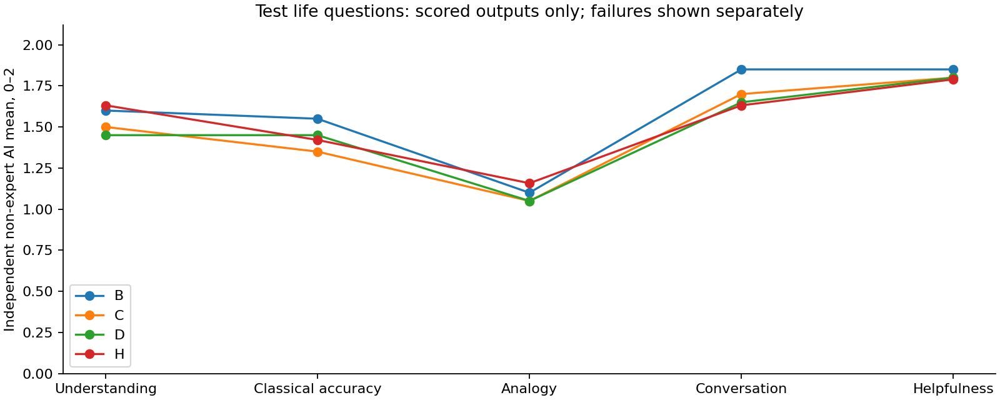
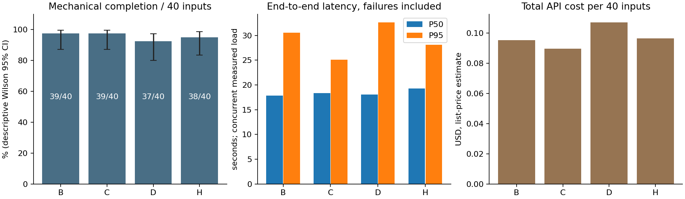

# 正式效果评测 · 2026-10-10

本轮测量冻结系统，不根据测试答案继续优化生产实现。结论适用于这批合成输入与当前 API 配置，不能外推为真实用户满意度或占卜准确率。**引用可追溯、检索命中与解释正确是三个不同能力。** 原实验结束时真人评分尚未进行；2026-10-11 已收到首批 14 份人工非专家试评，见下方修订说明。

## 2026-10-11 覆盖审计修订（不重写历史实验）

**原 80 个固定输入中 78 个无动爻；独立测试 40/40、生活题 40/40 均无动爻。** 首批人工材料 14/14 也都是静卦。原因是评测 fixture 人为指定爻值，并非生产随机起卦或变卦计算故障。固定配对输入并不要求使用静卦，原评测遗漏了动爻覆盖验收。

因此本报告的机械成功率、语义评分和费用仅描述所列合成输入，不能证明完整产品的动爻解释、本卦与变卦综合分析、相关爻注选择或真实随机起卦体验。尤其生活题缺少动爻，使默认按实际动爻选择注解的路径缺乏代表性。保留原始答案、失败、分母、AI评分和冻结文件，不把后续结果并入或替换本批数字。

用户已完成首批 14 份评价，原 `scores.csv` 实际为 Markdown 表，保持原字节；机器可读副本与分项汇总见[人工试评整理](../../evaluation/reports/context-20261011/human-baseline/README.md)。它是按场景选取的体验试评，不是随机用户满意度调查；“知识”分来自普通人工判断，不是专家 Gold。后续将机器核验、知识语义审查、用户体验分开，体验表只保留理解、关联、交流、帮助四维，并增加三个人工/AI分别登记的 CTX 错误标签。

**后续产品体验一律走真实随机起卦完整流程：一次抽到什么就保留什么，不改爻、不按好坏或卦象重抽、不给问题配指定卦。** 机制对照可以回放同一次真实抽取的会话输入以控制变量，必须标注为回放，不能计作新的随机产品运行。预先固定题目与运行预算；未达到某类动爻覆盖时如实报告，不为补齐类别筛选答案。定向卦爻单元测试和纯知识检索测试仍单列为工程验证。

完整指标见[可重算表](../../evaluation/reports/formal-20261010/analysis/tables.md)，真实回答见[匿名人工阅读包](../../evaluation/reports/formal-20261010/human/README.md)，实验配置、Trace、失败和复现入口见[记录索引](../../evaluation/reports/formal-20261010/README.md)。

## 1. 受测系统与冻结

基线 Git `4ae701bff993339dd7ab2c50c064d927ff17eae9`，graph v16 / prompt v16，知识发布 `knowledge-v3-20260926-r1`。Flash 主调用为 Thinking enabled / low / 8192，一次校验修复为同模型 disabled / 8192。参数中的 completion 上限包括思考和正文；未设置 seed 或 temperature。本轮没有修改生产模型、提示词、工具、语料或校验规则。

当前链路：FastAPI 接受会话请求 → 程序确定卦象、固定会话状态 → LangGraph 准备用户历史、原典及相关注解 → 精确文献目标由程序取证，其余适用追问由模型判断工具 → 有界 `get_passages` / `search_knowledge` → 生成普通段落与 claim 引用 → Schema、原文及显式归属校验 → 必要时一次修复 → SQLite 持久化。首次、风险、缺失和换题有确定性分支，不是所有问题都进入自主检索。

语料为1,076条固定发布记录，经典964、注解112。检索是中文双字组 BM25 加完整短语奖励、简繁归一及元数据过滤；不是向量检索。默认注解选择实际动爻或明确所问爻位。三家注解覆盖不完整，机器来源核对不是专家逐条校勘。

先完成3条已见真实图冒烟及1条真实 HTTP 会话冒烟，验证上一轮最终 v16、新建/追问、固定卦象、幂等不重复付费、未授权访问与持久化；冒烟4单元与正式成绩分开。[冻结清单](../../evaluation/reports/formal-20261010/freeze.json)保留22个生产/发布文件及输入、标签、Rubric 哈希；每阶段另存实际评测工具源码。评测工具的口径修正单列于[修正记录](../../evaluation/reports/formal-20261010/evaluator-corrections.md)，不冒充系统改进。

## 2. 样本与公平性

| 实验 | 规模 | 目的 |
|---|---:|---|
| 固定输入配对 | 40开发 + 40独立测试，各4策略，共320输出单元 | 工具策略、任务质量与成本 |
| 知识输入消融 | 预选12个知识输入 × 3组，共36单元 | 自身知识 / 原典 / 增强材料 |
| 实际连续对话 | 4会话 × 3轮，共12轮 | 真实上一轮回答影响后续 |
| 离线检索 | 32知识查询 × 3排序，K=1/3/5 | 定位、组覆盖与检索纯度 |
| 独立 AI 首评 | 248份计划输出 | 测试160、开发H40、RAG36、连续12 |
| 独立 AI 复评 | 事先选定16份 | 保留分歧，不覆盖首评 |

80个固定轮次对应67个独立衍生组（开发33、测试34）；每个分区20生活、16知识、4风险/换题边界。原计划的分类比例按本次预注册调整，知识题单独统计，不挤入自然交流平均分。午饭、理发、工作与项目取舍、家庭/社交、用户更正、条件变化、同问不同卦及同卦不同条件均保留。RAG和连续会话复用其中的组，不增加独立用户数。

测试题由独立任务编写并在输出前冻结；本轮不按开发或测试结果调优。它们是新合成题，并不表示模型预训练从未见过相关知识。已见历史失败留在开发侧。没有真人被试、专家 Gold 或正式人类满意度调查。旧版实验不并入本轮成绩。

四策略共用每题初始证据、卦象、历史、工具权限、生成/修复与预算：

- **B**：固定初始证据，无额外取证。
- **C/W1**：现有 rules-c-v1 确定性补检索，只读输入和当前证据，不读 Gold。
- **D/W2**：当前图关闭精确目标快捷分支，由模型路由；其他固定分支保留。
- **H**：当前未修改生产混合图。D/H差别仅为上述快捷策略；评测没有创建新的生产服务。

每题四组并发、启动顺序轮换；索引预热，缓存使用量逐次保存。延迟不包括排队，是本批并发条件下的观测，不是线上 SLA。每单元只运行一次，不择优补跑。800次调用 / 500万token共享硬上限覆盖失败与修复，每图单元另有8请求/10万token上限。所有数据合成，不采集生产私聊。

## 3. 独立测试的工程结果

| 策略 | 机械完成 | 模型请求 | reported tokens | P50 / P95 秒 | Repair成功/触发 | 估算USD |
|---|---:|---:|---:|---:|---:|---:|
| B | 39/40 | 45 | 188,115 | 17.85 / 30.57 | 4/5 | 0.095215 |
| C | 39/40 | 43 | 176,965 | 18.35 / 25.13 | 2/3 | 0.089689 |
| D | 37/40 | 70 | 279,784 | 18.09 / 32.65 | 4/7 | 0.107075 |
| H | 38/40 | 66 | 250,922 | 19.31 / 28.13 | 3/5 | 0.096354 |

机械完成包括如实不足回答，不等于任务完成。H机械完成率95%，Wilson描述区间约83.5%–98.6%；C为97.5%，约87.1%–99.6%。样本不支持两者稳定优劣的强结论。按同题衍生组进行2000次bootstrap的成对差见 `analysis/pairs.json`、`quality-pairs.csv`；区间与原始分母一起提供，不把小幅差异写成显著提升。

H首次Schema合法36/38，最后候选37/38；另2题由固定分支回应，无模型生成候选，不进入该分母。最后候选引文逐字/唯一原文恢复匹配190/191；其中可能包含被拒候选，不能当作191条已交付且语义正确的引文。D的最后180条引文全部匹配，仍有3个单元整体校验失败，直接说明局部引文匹配并不能替代 claim、归属和完整任务校验。

测试7个技术失败均保留：H单字符quote、B空段落、D claim不在正文、D/H显式作者归属失败、D资料缺失仍未满足引文要求、C quote不匹配。修复成功率分母是实际触发的单元，未修复项不填0。所有首次/最终候选和逐次usage可从原始jsonl核对。

请求层另有 **4/514次 `MODEL_INCOMPLETE_RESPONSE`**（均在测试阶段，finishReason=length，completion均8192）。其中test-16/H的8192全部为reasoning，正文为空；test-13/D、test-16/H、test-23/B经一次修复最终机械完成，test-32/D仍因claim不在正文失败。这表明Thinking Low仍会耗尽正文预算，但既有修复在本批恢复了3/4个此类单元。不能把最终行状态掩盖了的主调用失败漏报，也不能把“未超实验总预算”误写成“没有生成截断”。逐次记录见 `analysis/model-errors.json`。

## 4. 检索与知识输入

离线R1为双字组重合计数加短语奖励，R2为BM25加相同奖励，R3再加用户输入可解析的业务元数据过滤；三者均保留硬权限。R1/R2不是“无权限”基线。精确定位另表，不混成BM25成绩。

独立测试16个知识查询中2个发布集确实缺失，非空参考检索分母为14；有限明确对象Recall分母为12题22个请求对象。相关性参考由AI依据真实原文标注，另一个匿名AI评阅115个查询-文献对；三处与原始正例冲突保留unknown，没有擅自改成负例。严格的全库语义Recall因完整相关集合未知，仍为N/A。

| 测试排序 | Hit@5 | 已标注证据组覆盖 | 明确请求对象Recall@5 | Precision@5下界–上界 | 返回数 / 返回材料纯度下界–上界 |
|---|---:|---:|---:|---:|---:|
| R1 | 10/14 | 15/21 | 17/22 | .357–.386 | 46 / .543–.587 |
| R2 | 10/14 | 15/21 | 17/22 | .357–.386 | 46 / .543–.587 |
| R3 | 10/14 | 13/21 | 13/22 | .171–.186 | 13 / .923–1.000 |

Precision@5按预注册每题固定分母5，R3常不足5条，因此补报“实际返回材料纯度”作为事后诊断，未替换原指标。这里过滤降低噪声也漏掉目标，不支持“加过滤全面更好”。本小集也未显示BM25胜过简单重合；不能据此判断更大语料上的表现。K=1/3/5、按查询类别、开发侧及逐题结果见 `retrieval-judged/`。

精确流程按现有解析目标构造 `get_passages`：测试15题能构造请求，扣除2题确实缺失，13题中12题命中至少一组，覆盖17/20参考组。未全覆盖为test-32/33/34；这包含目标解析遗漏，不是工具按正确ID定位的单项准确率。作者、作品、卦爻定位保留每次参数及结果，避免把解析与底层读取混算。

知识消融的12题都是文献理解任务，不是生活建议；每组单次生成不修复。full使用同一规则流程取得的真实材料，未使用人工充分证据Oracle。memory保留同样的程序卦象与历史，只移除文献；只有问题的A0裸模型本轮未跑。memory明确允许已有知识、没有文献与引用；它只验Schema与空引用，原文匹配/输入证据faithfulness为N/A。不能把memory协议较易通过解读为其知识更可靠。三组语义均可对照共享原文参考，其中未提供给生成的材料清楚标记referenceOnly。

**消融的一个重要限制**：classic是“生产生成可见材料中的原典子集”，12题有5题该子集为空（作者请求的生产上下文本来只保留注解），不是每题人为配足基础原典。因此这批可测当前证据组织的效果，不能声称是普遍、均衡的原典RAG与注解RAG优劣实验。详见 `analysis/rag-evidence-profile.json`；原始请求保留，未发现问题后补料重跑。额外保存单次生成候选的AI评分诊断，包括被校验拒绝的内容，不把它算成已交付质量。

| 分区 / 输入 | 机械完成 | AI确认任务完成 | 知识均分 / 有效n | Tokens | 估算USD |
|---|---:|---:|---:|---:|---:|
| 开发 memory | 6/6 | 3/6 | 1.33 / 6 | 14,640 | .007157 |
| 开发 classic | 3/6 | 0/6 | 1.50 / 2 | 13,268 | .005929 |
| 开发 full | 4/6 | 3/6，另1未知 | 2.00 / 3 | 27,472 | .013453 |
| 独立 memory | 6/6 | 1/6 | .83 / 6 | 16,288 | .008118 |
| 独立 classic | 3/6 | 0/6 | 2.00 / 1 | 16,511 | .007851 |
| 独立 full | 4/6 | 4/6 | 2.00 / 4 | 29,665 | .014647 |

这里看到一个**窄范围的RAG收益**：独立6题具体注家/文义任务，增强材料组有4题完成，记忆组仅1题；按可核对资料，AI知识均分也提高。例test-24，记忆组把“可被立为侯/宜建侯”两种可能读法混在朱熹名下，增强组能抓住实际注文“以阳下阴、为民所归”的解释链。完整三组回答见代表全文。

但full仍2/6因结构/归属等校验无法交付。仅对已交付答案评分存在幸存者选择，因此另做事后候选诊断：将每题那次实际生成的未交付候选单列审查，独立full六份知识均分2.00，memory六份.83；这支持“材料帮助特定文义”的AI观察，**不改变full交付仍为4/6**，不证明生产稳定性或生活建议提高。classic只有少数答案包含可评传统解释，不能拿2.00这个低分母均值作为胜利。该实验没有专家复核，规模小且协议权限不完全相同，不作全局RAG提升或显著性结论。

## 5. Agent 的贡献与边界

| 独立测试策略 | 起始确有缺口的6题：获取齐备 | 生成实际可见齐备 | 工具请求 / ok / empty / 拒绝 |
|---|---:|---:|---:|
| B | 0/6 | 0/6 | 0 / 0 / 0 / 0 |
| C | 3/6 | 3/6 | 6 / 5 / 1 / 0 |
| D | 5/6 | 4/6 | 11 / 11 / 0 / 0 |
| H | 5/6 | 4/6 | 10 / 8 / 2 / 0 |

这说明在本批参考目标中模型检索补齐了规则未补齐的材料；并不证明其整体回答更好。D/H分别多出模型路由开销，H没有表现为每题都比D更快。对8题初始目标已充分的知识题，各组均无额外工具请求，未观察到该子集的冗余取证。

工具参数均通过服务端Schema/权限检查，测试C/D/H合计27/27请求没有被拒；其中3次为空结果。参数合法不等于搜对了内容；按AI目标组实际贡献的调用分别4/6、6/8、5/8（后两者分母为有标签可判的工具结果，其他调用不冒充无效）。未知来源的合理空探索不能统一算错误。真实评测没有覆盖足够多的恶意参数恢复事件；权限/去重/拒绝恢复主要依靠既有回归测试，不能据零拒绝宣称真实模型不会越权。

**证据在链路里丢失是本轮明确定位的机制缺陷。** 开发dev-31和测试test-33中D/H取得了目标原文，但 `backend/graph.py:generation_evidence` 对source_request按解析目标过滤，解析器只保留作者注解目标，原典未进入生成上下文。于是“已检索齐备”仍不能给出完整答案。开发材料及四组完整回答见 `analysis/context-filter-case.json`。这是生成证据筛选问题，不应归因为模型不会搜、也不应把工具命中算作端到端成功。本轮没有修复它。

## 6. 语义、对话与不确定性

五维分别为理解与事实承接、传统知识、现实关联、自然交流、实际帮助，0–2及逐条理由；N/A与失败分开。传统解释准确与现代应用合理独立记录，quote真不意味着claim受支持。来源仅用于查证的评分不混入“模型输入证据支持”；未引用的明显传统断言也记录，但人工式逐句检查不承诺穷尽全部隐含断言。

独立AI只读匿名问题、程序卦象、历史、完整答案及原文，隐藏策略、模型和Trace。评分标准在生成前固定。开发B/C/D共120份未做语义首评，保持pending；不能从它们的机械完成推算语义成功。16份复评保留原分数、理由与差异，不通过协商改成一致。评审由Codex独立子agent完成，身份与批次保留；工具未返回其精确服务模型标识，不假填另一种评审模型。AI不是领域专家，尤其文言词义可有误判；争议需要真人/专家复核。

独立测试生活20题的AI首评分如下（五维仅对可评答案平均）：

| 策略 | 核心任务完成 / 20 | 理解 | 知识 | 关联 | 交流 | 帮助 |
|---|---:|---:|---:|---:|---:|---:|
| B | 20/20 | 1.60 | 1.55 | 1.10 | 1.85 | 1.85 |
| C | 20/20 | 1.50 | 1.35 | 1.05 | 1.70 | 1.80 |
| D | 19/20 | 1.45 | 1.45 | 1.05 | 1.65 | 1.80 |
| H | 19/20 | 1.63 | 1.42 | 1.16 | 1.63 | 1.79 |

H有1个技术失败，五维有效n=19；B/C/D有效n=20。任务完成只是核心要求得到实质回应，不意味着没有局部错误。许多生活题的四策略实际走相同首次路径，差异也可能来自一次采样，**不能把这张表归因于工具策略的因果收益**。C/H生活配对的五维差异bootstrap区间均跨0；帮助差均值0，95%区间[-0.25,0.25]，尚未显示优势。

H的19份可交付生活答案中，AI标出传统误释5份、牵强类比6份、无依据心理3份、补造事实4份、过度展开3份、无依据预测5份；同答可多标签，不能相加成失败人数。它们是AI非专家意见，逐项原句和证据见评分明细。传统断言中，仅直接引文的84个检查项均获支持；解释命题61项为支持15、部分支持16、不支持8、unknown22。这个对比直接展示“引文真实但解释仍需审核”，不能把145个命题当145个独立样本。

16份独立复评五维完全一致的份数为13、15、12、9、12；平均绝对分差为0.188、0.063、0.250、0.438、0.250。交流分寸分歧最大，没有隐藏这一点或把两份评分平均成唯一真值。

独立40题的AI端到端任务完成，B/C/D/H分别为34/40、34/40、32/40、34/40；其中生活为20/20、20/20、19/20、19/20，知识为10/16、12/16、10/16、12/16，边界为4/4、2/4、3/4、3/4。各组2题发布集确实缺失的文献请求即使诚实回应，依冻结标准也不算“完成查证”，缺失识别另报，不能将此全部称作模型错误。H已正确识别这2题缺失。

H整体AI确认完成85%，描述区间约70.9%–92.9%；这个指标不代表无错误或真人满意度。C同为34/40，未显示生产混合策略整体完成收益；它们失败分布不同，逐题配对比总体均值更有解释力。

真实连续对话12轮均机械完成，AI也判断核心请求得到回应；仍明显存在局部质量问题。开发6轮五维均分为1.83 / 2.00 / 1.33 / 1.83 / 1.83；独立6轮为1.50 / 1.67 / 1.33 / 1.33 / 1.33。各6轮实际上仅2个相关会话，不能当6名独立用户，更不能由6/6宣称多轮问题已经解决。

例如陶艺追问第三轮，用户已说明能安排一个完整下午、只想体验久坐是否合适，回答仍重开“时间安排是否稳定”的问题；共同办展的追问，用户已愿意先试摆并问朋友意见，回答却反复要求回到有资历的第三方裁断。AI将独立6轮中的4轮标为无益展开、3轮标出无依据硬要求。完整历史与每轮答复都在代表全文和匿名连续对话包，建议优先人工阅读这些例子。

最终已收齐248份AI首评、16份独立复评；人工368行评分仍全空。未收集真人分数，没有将AI自评写作人工验收。

## 7. 完整案例与失败归因

[代表案例全文](../../evaluation/reports/formal-20261010/representative-answers.md)保留问题、历史、程序卦象、每个被选策略的完整回答、实际原文与未交付候选；所有输出均在人工包和原始阶段数据中，不只展示好例。

- **知识解释可用的例子**：test-29/H能根据朱熹“事當速悔…若悔之遲”区分“及时悔改”与“凡事越快越好”。这是特定文义的有依据辨析，非生活建议全面改善的证据。
- **材料获取不等于交付**：test-33/D/H的原典被生成筛选排除；H仍能讨论两家注解，D另触发归属校验失败。
- **机械失败不隐藏**：test-07/H修复后quote仍只有一个字符，未完成可交付回答；test-34/H已检索却显式作者归属校验失败。
- **真引文仍有误释/过度推断**：盲评中出现将历史中“他”补成“父亲”、把“劝相”解为“劝住自己”、从静卦推出现实无意外等现象。每项按具体答复与评审理由定位，不能用统一模型分数代替阅读。

## 8. 成本、工程与复现

全部372个运行单元（含4个独立冒烟单元）产生514次真实模型请求，reported tokens **1,983,982**，其中输入673,044、输出1,310,938。已返回的reasoning合计1,064,018，39次请求没有该细项，完整reasoning总数保持unknown。总usage均返回，未知总用量0次；逐请求、ledger与汇总一致。累计估算 **$0.846749**，约每模型请求$0.001647，失败调用也计费。

372单元中350机械完成、22校验失败，0预算中止、0未执行。这是不同策略、知识输入和重复场景的混合账目，**不能用350/372宣称生产成功率**。生产H正式独立测试仍以38/40为准。36个知识单次生成有10个校验失败；它们没有修复，不能与完整图的修复后成功率直接比较。

输入/输出/缓存/推理明细、单请求金额和每组费用见 `analysis/usage.json`、`groups.csv`。P50/P95、均值、原始单元延迟及配对bootstrap见 `cells.csv`、`pairs.json`；没有把未报告字段填零。

价格按2026-10-10官方价目与逐次缓存命中/未命中/输出usage估算，周六Flash费率：每百万token缓存命中$0.003、未命中$0.15、输出$0.6。[官方价格](https://api-docs.deepseek.com/quick_start/pricing/)及本地 `price_table.json` 留存核实日期；这是估价，不是账户账单。reasoning已包含在completion费用，不重复收费；未返回的reasoning明细记unknown，不填0。Codex独立评审的费用不含在应用API费用内。

本轮新增 `evaluation/formal_run.py`、`formal_retrieval.py`、`formal_stats.py`、`formal_analysis.py`、`formal_report.py`、`formal_plot.py`、`formal_delivery.py`、冻结数据/评分规则、对应回归测试及报告；同步README、SPEC、architect、tasklist、evaluation、EVAL_PLAN。生产backend、前端、发布语料未修改。没有增加评测服务或在线模型调用层。

工程验证：Python **331项通过**、TypeScript **41项通过**，lint/build通过；最终离线重算、哈希冻结、计费ledger、匿名评分覆盖与空白真人表另做交付完整性校验。日志见 `verification/`。工程通过不是自然对话达标。

复算主要表只需项目依赖，不需要API密钥：`python -m evaluation.formal_report`；图表用系统matplotlib运行 `python evaluation/formal_plot.py`。重新真实调用必须换新目录，顺序运行各阶段，不能覆盖本批或并发启动共享ledger进程。实际API别名可更新，输出可追溯不代表逐字可重现。

## 9. 能说与不能说

可以说：完成冻结40+40输入、有效规则与模型路由的受控对照；RAG可把真实出处带入回答，模型路由在部分模糊缺口下能取到规则遗漏材料；已量化代价并定位“取到后过滤掉”的链路缺陷。确定性计算、权限、幂等和引文匹配有工程验证。

不能说：Agent整体优于Workflow、RAG已普遍提高生活建议、模型解释都忠于经典、95%机械完成等于95%用户满意、AI评分等于专家或真人结论。当前主要短板仍是传统词义、无依据用户事实和类比边界，以及一次修复的偶发失效。

下一步先由用户匿名阅读并评分少量生活/连续对话与有争议文义，确认AI判据；再另开优化轮修复已定位的证据筛选和归属失败。若据这批结果改动系统，它们即成为已见回归数据，新的效果证明需要新输入。本轮停止于评测与报告，不实施这些生产修复，不推送远端。
